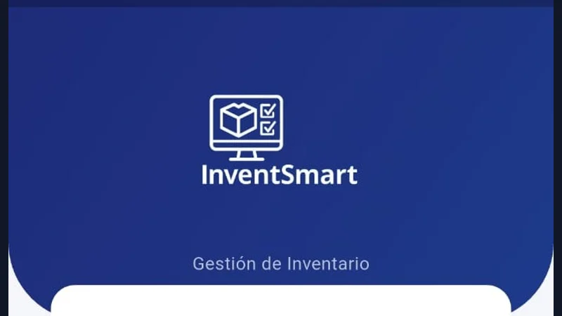
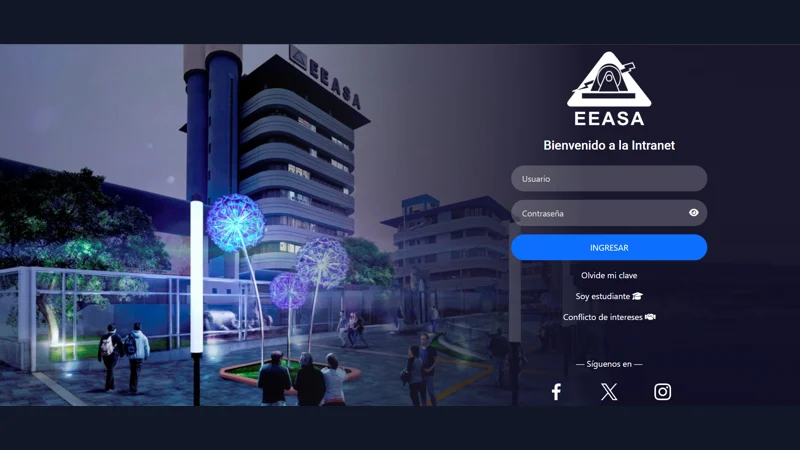

<h1 align="center">✦ Hola, soy Michelle Tunja</h1>

  

  Soy estudiante de Ingeniería en Software en la Universidad Técnica de Ambato, Ecuador. Me interesa el desarrollo web y móvil y quiero seguir aprendiendo sobre seguridad informática. Durante mi pasantía colaboré en el frontend de SISREC para la EEASA.

  

<h2>🚀 Proyectos destacados</h2>

<table width="100%">
  <tbody>
  <tr>
<td width="50%" valign="top">
       
      <h3>📱 InventSmart móvil</h3>
      
Permite consultar el inventario y realizar compras en línea desde el teléfono.

      
    </td>
<td width="50%" valign="top">
       
      <h3>⚡ SISREC · EEASA</h3>
      
Durante mi pasantía colaboré en el desarrollo del frontend de SISREC para la EEASA.

      
    </td>
  </tr>
  </tbody>
</table>

<h2>🛠️ Mis habilidades</h2>

<h3>💻 Lenguajes</h3>

 &nbsp;  &nbsp;  Java · Python · R

<h3>🗃️ Bases de datos</h3>

 &nbsp;  &nbsp;  MySQL · PostgreSQL · Oracle

<h3>🌐 Desarrollo web y backend</h3>

 &nbsp;  &nbsp;  &nbsp;  HTML5 · React · Angular · Spring Boot

<h3>📱 Desarrollo móvil</h3>

 &nbsp;  Android · Flutter

<h3>⚙️ Sistemas y herramientas</h3>

 &nbsp;  &nbsp;  Linux · Docker · Postman

<h3>🔀 Control de versiones</h3>

 &nbsp;  &nbsp;  Git · GitHub · GitLab

<h2>📡 Contacto</h2>

📍 Ambato, Ecuador

   &nbsp; 

<h2>📊 Estadísticas de GitHub</h2>

  

  
Ver actividad y lenguajes más usados

  

    
    
  

